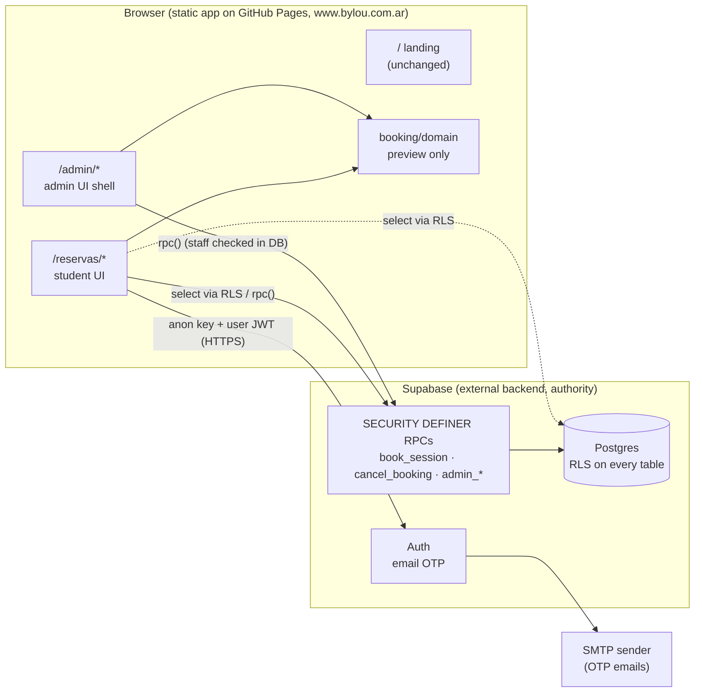
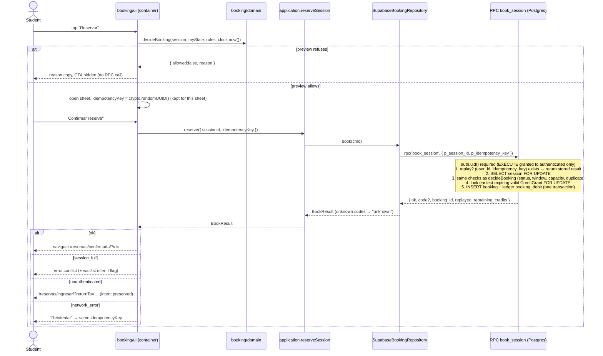
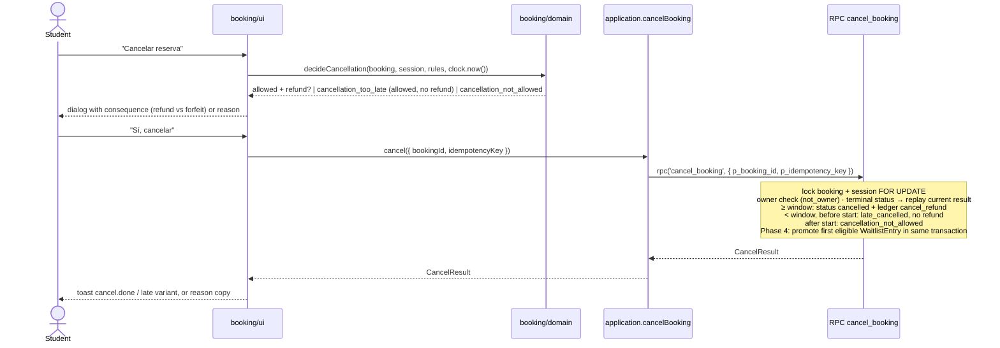
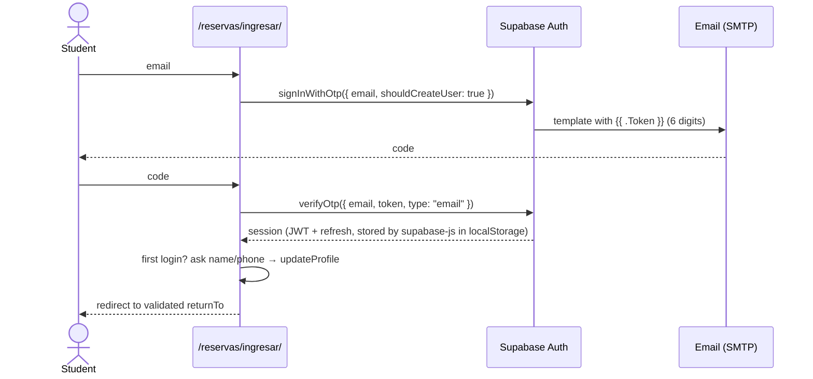

# Booking Core — Architecture

Phase 1 · 2026-10-13 · Status: **Draft**
Implements ADR-001…ADR-011 in [DECISIONS](./DECISIONS.md). Scope and stories: [PRD](./PRD.md). Tables, RLS and RPC internals: [DATA_MODEL](./DATA_MODEL.md). Delivery order: [ROADMAP](./ROADMAP.md).

Code in `booking/domain` is the source of truth for types and codes; if this doc and the code diverge, fix the doc.

---

## 1. System context



| Trust zone | Holds | Never holds |
|---|---|---|
| Browser / `out/` | Supabase URL, anon key, user JWT (localStorage), domain logic for **preview** | service-role key, authority over capacity/credits/roles |
| Supabase | Data, roles (`profiles.role`), RLS, RPCs, auth | UI, brand |

## 2. Module boundaries (ADR-007)

| Module | Contains | May import | Must not import |
|---|---|---|---|
| `booking/domain` | Entity types, value objects, policies (`decideBooking`, `decideCancellation`, credit selection, availability), result codes | nothing outside itself | react, next, `@supabase/*`, `brands/*`, `booking/*` other modules |
| `booking/application` | Use cases (`listAgenda`, `reserveSession`, `cancelBooking`, `getMyAccount`), port interfaces | `domain` | react, next, `@supabase/*`, `brands/*`, `infrastructure` |
| `booking/infrastructure` | `SupabaseBookingRepository`, `SupabaseAuth`, `MockBookingRepository`, `MockAuth`, `SystemClock`, adapter factory | `domain`, `application` (ports), `@supabase/supabase-js` | react, `ui`, `admin`, `brands/*` |
| `booking/config` | `StudioRules` defaults schema + validation, terminology keys, feature flags | `domain` (types) | react, `@supabase/*`, `brands/*` |
| `booking/theme` | `BookingTheme` / `BrandConfig` contract, `themeToCssVars()`, `<BookingThemeScope>` | `config` (types) | `domain` logic, `@supabase/*`, `brands/*` |
| `booking/ui` | Student presentational + container components, hooks, providers | `domain`, `application`, `theme`, `config` | `infrastructure`, `@supabase/*`, `brands/*` |
| `booking/admin` | Admin components and containers | same as `ui` (+ `ui` primitives) | same as `ui` |
| `brands/bylou`, `brands/demo-studio` | `BrandConfig` values: theme tokens, copy, terminology, rule defaults | `theme`, `config` (types only) | anything else under `booking/` |
| `app/reservas/**`, `app/admin/**` | Route entry files = **composition root** (pick brand + adapters, wrap providers, export metadata) | everything above | — |

**Dependency rule:** arrows point inward only: `app` → `ui`/`admin` → `application` → `domain`; `infrastructure` → `application` ports → `domain`; brands → `theme`/`config` contracts. UI receives adapters through a React context created in the composition root; it never imports `infrastructure`.

**Enforcement:** a Vitest test scans import specifiers per folder against the table above (ESLint is broken, ADR-007/ADR-012). Covered paths: `booking/domain`, `booking/application`, `booking/ui`, `booking/admin`.

## 3. Ports

Sketch; final names live in `booking/application/ports.ts`. All instants are UTC ISO-8601 strings (`timestamptz` in DB).

```ts
// booking/application/ports.ts
import type {
  ClassType, Session, Booking, StudioRules,
  BookReasonCode, CancelReasonCode,
} from "@/booking/domain";

export interface Clock {
  now(): Date; // injected so domain/app tests control time
}

export interface SessionAvailability {
  session: Session;          // status, modality, capacity, startsAt, endsAt
  classType: ClassType;
  confirmedCount: number;    // aggregate from a SECURITY DEFINER view/RPC; never other users' rows
  myBookingId: string | null;
  myWaitlistPosition: number | null; // Phase 4
}

export interface CreditBalance {
  available: number;              // non-expired, not consumed
  nextExpiry: string | null;      // UTC ISO
}

export type TransportCode =
  | "unauthenticated" | "forbidden" | "invalid_input" | "network_error" | "unknown";

export type BookResult =
  | { ok: true; bookingId: string; replayed: boolean; remainingCredits: number }
  | { ok: false; code: BookReasonCode | TransportCode };

export type CancelResult =
  | { ok: true; bookingId: string; status: "cancelled" | "late_cancelled"; refunded: boolean; replayed: boolean }
  | { ok: false; code: CancelReasonCode | TransportCode };

export interface BookingRepository {
  getStudioRules(): Promise<StudioRules>;
  listClassTypes(): Promise<ClassType[]>;
  listAgenda(range: { from: string; to: string }): Promise<SessionAvailability[]>;
  getSession(id: string): Promise<SessionAvailability | null>;
  listMyBookings(): Promise<Array<{ booking: Booking; session: Session; classType: ClassType }>>;
  getMyCreditBalance(): Promise<CreditBalance>;
  book(cmd: { sessionId: string; idempotencyKey: string }): Promise<BookResult>;
  cancel(cmd: { bookingId: string; idempotencyKey: string }): Promise<CancelResult>;
}

export interface AuthUser { id: string; email: string; displayName: string | null; isStaff: boolean }
export type AuthCode = "invalid_email" | "invalid_code" | "code_expired" | "rate_limited" | "network_error" | "unknown";

export interface AuthPort {
  getUser(): Promise<AuthUser | null>;
  onChange(listener: (user: AuthUser | null) => void): () => void; // returns unsubscribe
  requestCode(email: string): Promise<{ ok: true } | { ok: false; code: AuthCode }>;
  verifyCode(email: string, code: string): Promise<{ ok: true; user: AuthUser } | { ok: false; code: AuthCode }>;
  updateProfile(input: { displayName: string; phone?: string }): Promise<{ ok: boolean }>;
  signOut(): Promise<void>;
}
```

Admin operations (`AdminRepository`: sessions, roster, attendance, grants, waitlist) are added in Phase 4 as a separate port so the student bundle path never depends on them. `isStaff` drives UI only; the DB re-checks via `is_staff()` (ADR-005).

## 4. Flows

Principle: the client **previews** with the same domain policy the RPC enforces; the RPC is the only authority (ADR-005). Business refusals are returned as data (`{ ok:false, code }`, HTTP 200); only unexpected failures raise.

### 4.1 Reserve



### 4.2 Cancel



Window boundary: a cancellation exactly at `startsAt − cancellationWindowHours` refunds (inclusive). Edge cases are covered by domain unit tests and mirrored SQL tests.

## 5. Result code contract

One vocabulary for `booking/domain` decisions, RPC JSON `code`, application results and UI copy. Adding a code requires updating the domain union, the RPC, the mapper and a copy key in the same slice.

| Code | Produced by | Meaning | UI (copy key → action) |
|---|---|---|---|
| `session_cancelled` | book | Session status `cancelled` | "Esta clase se canceló" → back to agenda |
| `session_started` | book | `now ≥ startsAt` | "En curso", CTA hidden |
| `booking_not_open` | book | Before `startsAt − bookingWindow.opensDaysBefore` | "Abre el {date}" |
| `booking_closed` | book | Within `closesMinutesBefore` of start | "Ya no se puede reservar online" + contact |
| `session_full` | book | `confirmedCount ≥ capacity` | `error.conflict` → waitlist offer [FLAG] |
| `already_booked` | book | Active booking exists for (user, session) | → "Mis reservas" |
| `no_valid_credit` | book | No non-expired grant with remaining credit | `pack.none` → `pack.none.cta` |
| `not_found` | book, cancel | Unknown id or not visible | "No encontramos esta clase/reserva" |
| `not_owner` | cancel | Booking belongs to another user | same copy as `not_found` (no detail leak) |
| `cancellation_too_late` | cancel (preview + result info) | Inside window: **allowed**, credit forfeited, status `late_cancelled` | warning in dialog; toast late variant |
| `cancellation_not_allowed` | cancel | Session started, or `lateCancelPolicy = block` | `cancel.closed` → IG contact |
| `unauthenticated` | transport | No/expired JWT | → `/reservas/ingresar/?returnTo=` |
| `forbidden` | transport | Admin RPC by non-staff | "Sin acceso" |
| `invalid_input` | transport | Malformed args | generic error + retry |
| `network_error` | transport | Fetch failed / timeout | `error.load` + "Reintentar" (same key) |
| `unknown` | transport | Unmapped error | generic error, logged to console only |

Shapes: domain `Decision<C> = { allowed: true; refund?: boolean; warning?: C } | { allowed: false; reason: C }`; RPC returns snake_case JSON mapped 1:1 to `BookResult` / `CancelResult` (§3).

## 6. Routing under static export (ADR-001, ADR-003)

| Route | File | Notes |
|---|---|---|
| `/reservas/` | `app/reservas/page.tsx` | Agenda; indexable later, `noindex` while mock |
| `/reservas/clase/?id=` | `app/reservas/clase/page.tsx` | Session detail |
| `/reservas/ingresar/` | `app/reservas/ingresar/page.tsx` | OTP sign-in; `?returnTo=` |
| `/reservas/mis-reservas/` | `app/reservas/mis-reservas/page.tsx` | |
| `/reservas/confirmada/?id=` | `app/reservas/confirmada/page.tsx` | |
| `/admin/…` | `app/admin/**/page.tsx` (`/admin/clase/?id=` etc., see `UX_DESIGN.md` §2.1) | Static shell; `noindex`; data gated by RLS/RPC |

Query-param page pattern:

1. `page.tsx` is a server component: exports `metadata`, renders `<Suspense fallback={<Skeleton/>}><Container/></Suspense>`. Without `Suspense`, `useSearchParams` fails the export build.
2. The container (client) reads `useSearchParams().get("id")`, validates it (UUID shape), then fetches. Missing/invalid → `not_found` state.
3. The exported HTML is a shell (`reservas/clase/index.html`), so direct load and refresh return 200 on GitHub Pages (`trailingSlash: true`).
4. Internal links use `next/link` (`{ pathname: "/reservas/clase/", query: { id } }`) so `basePath` applies; no `[id]` segments, no 404-redirect SPA hacks.
5. `returnTo` is accepted only if it starts with `/reservas/` (open-redirect guard).

Layouts `app/reservas/layout.tsx` and `app/admin/layout.tsx` are client-provider hosts (theme scope, adapters, auth context, skip link). The root layout and `app/page.tsx` are untouched.

## 7. Configuration and studio rules

| Concern | Source of truth | Read by |
|---|---|---|
| `StudioRules` used for **enforcement** (window, cancellation hours, late policy, credits per booking, timezone) | DB (single settings row, seeded from the brand defaults) | RPCs; client via `getStudioRules()` for preview |
| `StudioRules` defaults | `brands/<brand>/rules.ts`, validated by `booking/config` | seed script, mock adapter |
| Feature flags (`features.waitlist`, `showCatalogStep`) | `BrandConfig` (build-time) | UI |
| Terminology + copy | `BrandConfig` (build-time) | UI |
| Active brand | `booking/config/active-brand.ts` (one import line) | composition root |

Reason: rules must be readable by Postgres to be authoritative; keeping them only in TS would make the RPC trust the client. Admin editing of rules is V2 ([PRD §3.2](./PRD.md#32-v2-after-mvp-each-needs-its-own-decision)).

## 8. Theme application (ADR-008)

1. `BrandConfig = { id, name, logo, contact, theme: BookingTheme, copy, terms, rules, features }` (contract in `booking/theme`, values in `brands/*`). Token roles follow `UX_DESIGN.md` §6.
2. `themeToCssVars(theme)` (pure, unit-tested) maps roles to the shadcn variable names already wired in `app/globals.css` `@theme inline` (`--background`, `--primary`, `--radius`, …) plus the new ones (`--primary-hover`, `--success`, `--shadow-card`, …).
3. `<BookingThemeScope brand>` renders `<div data-booking-theme={brand.id} style={vars}>` in the `/reservas` and `/admin` layouts, sets the canvas background, `:focus-visible` outline and fonts inside the scope. `:root` and landing styles are not modified.
4. Components consume Tailwind semantic utilities (`bg-primary`, `rounded-[var(--radius-button)]`) and copy via `useCopy(key)` / `useTerm(key)`; no hex literals or brand strings in `booking/ui`.
5. Journey G check: switching `active-brand.ts` to `demo-studio` must produce no diff in `booking/domain` / `booking/application`.

## 9. Auth on static hosting (ADR-004)



- No server callback and no PKCE verifier are needed: the code is typed into the same page, so cross-device email opening works.
- Profile row is created by a DB trigger on `auth.users` insert with `role = 'student'`; users can update only `display_name`/`phone` (DATA_MODEL).
- Supabase settings (owner-gated in prod): email template must contain `{{ .Token }}`; Site URL `https://www.bylou.com.ar/reservas/ingresar/`; redirect allowlist the same plus `http://localhost:3000/reservas/ingresar/` (trailing slash); custom SMTP (the built-in sender is rate-limited and not for production).
- Session refresh is client-side (`autoRefreshToken`). Guards in layouts are UX only; security is RLS/RPC.

## 10. Environments and configuration

| Environment | Adapter | Data | Auth / email | Used for |
|---|---|---|---|---|
| **local-mock** | `MockBookingRepository` + `MockAuth` (in-memory, deterministic seed, fixed demo code shown on screen) | Fixtures in `booking/infrastructure/mock`; banner "Datos de demostración" | none | Phase 2 UI, component tests, E2E smoke |
| **supabase-local** | Supabase adapters → `supabase start` (Docker) | `supabase/migrations` + `seed.sql` | Local mail catcher (Mailpit/Inbucket) | Phase 3+ dev, SQL tests (RLS, concurrency, idempotency) |
| **supabase-prod** | Supabase adapters → cloud project | Real | Custom SMTP | GitHub Pages production — **owner-gated** |

There is no staging: Pages serves one site and deploys only from `main` (`REPOSITORY_AUDIT.md` §6).

| Variable | Public? | Set in | Notes |
|---|---|---|---|
| `NEXT_PUBLIC_SUPABASE_URL` | Yes (in bundle) | `.env.local`; GitHub repo **variable** for the Build step | Required when `NEXT_PUBLIC_BOOKING_DATA_SOURCE=supabase` (ADR-013). |
| `NEXT_PUBLIC_SUPABASE_ANON_KEY` | Yes (in bundle, RLS-protected) | same | Anon or publishable key only. |
| `NEXT_PUBLIC_BASE_PATH` | Yes | existing CI env (`""`) | Unchanged. |
| Service-role key, DB password, `SUPABASE_ACCESS_TOKEN` | **Secret** | Owner's machine / Supabase dashboard only | Never in frontend, repo, `.env.example` values, or CI build env. Prod migrations are run by the owner. |

`.env.example` documents the two public vars with empty values. A test/CI grep rejects `service_role` patterns in `out/` and the repo (SE-03).

## 11. Open issues

| # | Issue | Proposed handling |
|---|---|---|
| 1 | `UX_DESIGN.md` S6 / `cancel.closed` assume late cancellation is **blocked**; ADR-011 allows it with forfeit. | Add a `cancel.late` copy key ("Faltan menos de {h} h: si cancelás, la clase no vuelve a tu pack."); keep `cancel.closed` for `cancellation_not_allowed`. UX sheet example "12 h" is illustrative; copy is rule-driven. |
| 2 | `success.mail` ("Te mandamos los detalles…") implies a confirmation email, which MVP does not send. | Hide the key until transactional email (V2) exists. |
| 3 | `REPOSITORY_AUDIT.md` integration plan proposes `/reservas/admin/` and `/reservas/auth/callback/`. | Superseded by ADR-003 (`/admin/`, `/reservas/ingresar/`); no callback page needed with OTP. |
| 4 | Rules enforcement needs DB-resident `StudioRules`; ADR-007 places rules in `config`/brands only. | §7: DB is enforcement source, brand file holds defaults. Align with DATA_MODEL. |
| 5 | Refund to a CreditGrant that has already expired is worthless. | DATA_MODEL to decide (refund to original grant vs. extend vs. new grant); default: refund to original grant. |
| 6 | ~~Adapter selected by env presence~~ → resolved by **ADR-013**: explicit `NEXT_PUBLIC_BOOKING_DATA_SOURCE`, config-error state when missing, no landing link before release. | — |
