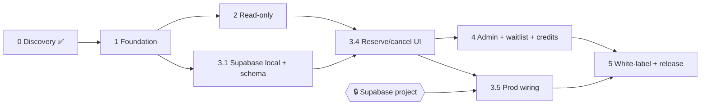

# Booking Core — Roadmap

Updated 2026-10-13 · Live status and blockers: [PROGRESS](./PROGRESS.md) · Stories: [PRD](./PRD.md) · Design: [ARCHITECTURE](./ARCHITECTURE.md) · Schema: [DATA_MODEL](./DATA_MODEL.md) · ADRs: [DECISIONS](./DECISIONS.md)

Legend: ✅ done · 🔄 in progress · ⏳ planned · 🔒 **owner-gated** (external, costly or production-affecting; needs explicit approval per the brief).

## Overview

| Phase | Goal | Status | Exit criterion |
|---|---|---|---|
| 0 Discovery | Audit repo, reference, UX; pick stack | ✅ | ADRs 001–012 written |
| 1 Foundation | PRD, architecture, data model, domain core + tests, theme contract | 🔄 | Domain invariants green in Vitest; owner answers to PRD §6 |
| 2 Read-only slice | `/reservas` agenda on mock data, Bylou theme | ⏳ | Agenda + detail work at 360px, keyboard, refresh |
| 3 Transactional booking | Auth, real sessions, atomic book/cancel | ⏳ | Journeys A–E proven on Supabase local |
| 4 Admin + waitlist + credits | Lou operates without SQL | ⏳ | Journey F + D (waitlist) proven |
| 5 White-label + release | `demo-studio`, E2E, release | ⏳ | Journeys A–H green on static `out/`; owner publishes |

## Definition of Done

**Base DoD — applies to every slice** (from the brief):

- [ ] Story IDs and acceptance criteria referenced in the commit/PR and traceable to tests.
- [ ] `pnpm exec tsc --noEmit`, tests and `NEXT_PUBLIC_BASE_PATH="" pnpm build` green; lint failure is pre-existing (ADR-012) and stated.
- [ ] Rule/security/concurrency tests proportional to risk.
- [ ] Mobile (360px), keyboard and error states reviewed (UI slices).
- [ ] No secrets; no unrelated changes; `pnpm-workspace.yaml` not committed; lockfile pnpm 9-compatible (ADR-010).
- [ ] Small descriptive conventional commit(s).
- [ ] Docs and `PROGRESS.md` updated.
- [ ] Concrete reproduction steps for manual review.

Each slice below lists only its **extra** DoD items.

## Phase 0 — Discovery ✅

| Slice | Output |
|---|---|
| 0.1 Repo audit | `REPOSITORY_AUDIT.md` |
| 0.2 Reference analysis | `REFERENCE_ANALYSIS.md` |
| 0.3 UX + visual system | `UX_DESIGN.md` |
| 0.4 Stack and ADRs | `DECISIONS.md` (ADR-001…012) |

## Phase 1 — Foundation 🔄

| Slice | Scope | Depends on | Extra DoD | Status |
|---|---|---|---|---|
| 1.1 Product + architecture docs | `PRD.md`, `ARCHITECTURE.md`, `ROADMAP.md`, `DATA_MODEL.md` | 0 | Cross-links valid; no duplicated content; open issues listed | 🔄 |
| 1.2 Test tooling | Vitest + `test` script; domain purity import-scan test | 0 | Lockfile regenerated with pnpm 9; CI workflow untouched | 🔄 |
| 1.3 Domain core | Types (shared vocabulary), `decideBooking`, `decideCancellation`, credit selection, availability, result codes | 1.2 | Unit tests for every reason code and window edges (inclusive boundary, UTC/TZ day grouping); domain imports nothing external | 🔄 |
| 1.4 Theme contract | `BookingTheme`/`BrandConfig`, `themeToCssVars`, `brands/bylou` (real tokens), `brands/demo-studio` skeleton | 1.2 | Contract type-checks both brands; contrast pairs from `UX_DESIGN.md` §5 respected | 🔄 |
| 1.5 Owner decisions | Answers to [PRD §6](./PRD.md#6-owner-questions-most-decision-relevant-first); update ADR-011 status | 1.1 | 🔒 Owner input; DECISIONS updated | ⏳ |

## Phase 2 — Read-only slice ⏳

| Slice | Scope | Depends on | Extra DoD |
|---|---|---|---|
| **2.1 Agenda (first slice)** | `/reservas/` read-only agenda: `MockBookingRepository`, Bylou theme scope, filters, day strip, spots, empty/loading/error states (ST-01, PL-03) | 1.3, 1.4 | Mock banner visible; `noindex`; refresh on `/reservas/` returns 200 from `out/`; landing `/` unchanged; reduced-motion respected |
| 2.2 Session detail | `/reservas/clase/?id=` with `Suspense` + not-found state (ST-02) | 2.1 | Direct load + refresh with valid/invalid `id`; links via `next/link` |
| 2.3 Landing entry | Data-only "Reservas" entries in `NAV_LINKS` / `NAV_PANEL` (`UX_DESIGN.md` §4) | 2.1 | Nav pill checked 1101–1280px; 🔒 publishing to production = merge to `main` |
| 2.4 PR build check | New workflow that builds (no deploy) on PRs | 1.2 | `main.yml` unchanged; 🔒 owner approves CI change |

## Phase 3 — Transactional booking ⏳

| Slice | Scope | Depends on | Extra DoD |
|---|---|---|---|
| 3.1 Schema + RLS (local) | `supabase/` migrations, RLS on every table, `is_staff()`, profile trigger, seed (DATA_MODEL) | 1.3 | SQL tests: SE-02 matrix (anon, student A/B, staff); rollback documented per migration |
| 3.2 Booking RPCs | `book_session`, `cancel_booking` (+ settings row for `StudioRules`) | 3.1 | SQL tests: SE-01 parallel race, ST-05 replay, ST-09 window edges and refund-once; codes match ARCHITECTURE §5 |
| 3.3 Auth | `SupabaseAuth` + `/reservas/ingresar/` OTP + profile completion + `returnTo` guard (ST-03) | 3.1 | Local mail catcher flow verified; open-redirect test |
| 3.4 Reserve / cancel UI | Supabase adapter, confirm sheet, confirmation, Mis reservas, credit balance, `.ics`, cancel dialog (ST-04…ST-11) | 2.2, 3.2, 3.3 | Retry reuses idempotency key; every reason code has copy; dialog focus trap/Esc/return |
| 3.5 Production wiring | 🔒 Create Supabase project; 🔒 configure OTP template, Site URL, redirect allowlist, custom SMTP; 🔒 apply migrations to prod; 🔒 add repo variables for public URL/key; 🔒 bootstrap Lou as `admin` via SQL | 3.4 | Owner executes each step from written instructions; secrets never pasted in chat; `service_role` grep clean (SE-03) |

Credits in Phase 3 are granted by SQL/seed (no admin UI yet) so booking can debit real grants.

## Phase 4 — Admin + waitlist + credits ⏳

| Slice | Scope | Depends on | Extra DoD |
|---|---|---|---|
| 4.1 Admin shell + Hoy | `/admin/` layout, staff guard UX, today view, roster, attendance (AD-01, AD-06, AD-07) | 3.x | SQL: admin RPCs `forbidden` for students; attendance editable ≤7 days |
| 4.2 Sessions | Class types, single + weekly-recurring creation, capacity edit, cancel session with refunds (AD-02…AD-05) | 4.1 | SQL: capacity ≥ confirmed; session cancel refunds all, once |
| 4.3 Students + credits | Student search, grant pack, `admin_adjust` with reason, ledger view, book/cancel on behalf (AD-08…AD-10) | 4.1 | Ledger append-only (no UPDATE/DELETE grants); balance = ledger sum |
| 4.4 Waitlist [FLAG] | Join/leave/position, auto-promotion inside `cancel_booking` and capacity increase (ST-12) | 4.2, 🔒 ADR-011 promotion rule confirmed | SQL: FIFO, skip ineligible, promotion debits once; flag off hides all UI |

## Phase 5 — White-label proof + release ⏳

| Slice | Scope | Depends on | Extra DoD |
|---|---|---|---|
| 5.1 `demo-studio` by config | Full `demo-studio` BrandConfig; switch via `active-brand.ts` (PL-01) | 4.x | Zero diff in `booking/domain` and `booking/application`; component tests run under both brands |
| 5.2 E2E | Playwright on served `out/`: journeys A–H, refresh on every route, mobile viewport | 5.1 | All journeys green; run documented |
| 5.3 Release | A11y pass (`UX_DESIGN.md` §5.2), release checklist, `PROGRESS.md` handoff | 5.2 | 🔒 Owner approves merge to `main` (production deploy) |

## Owner-gated steps (summary)

| Step | Phase | Why gated |
|---|---|---|
| Answer PRD §6 questions | 1.5 | Business rules |
| Merge to `main` (publishes to www.bylou.com.ar) | 2.3, 5.3 | Production |
| New CI workflow | 2.4 | Pipeline change |
| Create Supabase project, SMTP sender | 3.5 | External service, possible cost |
| Prod auth settings, migrations, repo variables, admin bootstrap | 3.5 | Production data and settings |
| Waitlist promotion rule | 4.4 | Business rule |
| Mercado Pago | V2 | Payments, contract |
